<a id="zh"></a>

# Comfy工作台（Comfy Workbench）

**中文** | [English](#english)

> 装上、连上你的 ComfyUI、挑一个内置模板，手机上点一下出图。不连线，不改节点。

[](https://github.com/Mimikkoro1/comfy-workbench-android/releases/latest) [](LICENSE) [](https://github.com/Mimikkoro1/comfy-workbench-android/actions/workflows/android-ci.yml)

国内访问 GitHub 不稳定的话，可以看 Gitee 镜像：[gitee.com/Mimikkoro1/comfy-workbench-android](https://gitee.com/Mimikkoro1/comfy-workbench-android)（代码同步，APK 以 GitHub Releases 为准）。

**Comfy工作台** 是一个原生 Android（Kotlin + Jetpack Compose）应用。自带 6 个内置模板，开箱就能出图；也可以把自己的 ComfyUI 工作流导出成 API 格式导进来。参数变成几个输入框：提示词、种子、尺寸、参考图、一条参考视频。点一下就提交到你自己的 ComfyUI。

它不是手机上的节点编辑器，也不替代 ComfyUI 网页端。节点和连线留在电脑上，手机只负责出图。

人不在电脑前，也能用同一套已经调好的工作流出图、图生图、图生视频、反推提示词。

**0.5.0 是第一个稳定版**：直连 ComfyUI 的主要功能已经定型，今后以修大家反馈的问题为主，不再频繁发版。

## v0.5.0 新在哪

更早的版本见 [Releases](https://github.com/Mimikkoro1/comfy-workbench-android/releases)。

- **两种界面风格**：「设置 › 外观」新增「界面风格」——「毛玻璃」（默认，老用户升级后不变）和「经典」（实心素色面，更清爽）。经典风格可选浅色 / 深色 / 跟随系统，Android 12+ 另有动态取色和纯黑深色
- **应用内更新**：检查更新国内优先走 Gitee，失败自动换 GitHub；更新说明按界面语言显示；新版本可直接在应用内下载并安装
- **连接电脑更省心**：适配 Android 17 的局域网权限；自动查找只走 WiFi，开着 VPN 也能找到电脑；服务器地址少写协议、端口、斜杠也能连；连接失败会说清卡在哪一步，可复制详细信息；设置首页的服务器行新增连接状态点（绿 / 红 / 灰）
- **队列更可靠**：「强制结束」同时清空电脑端 ComfyUI 的队列；排队中点一下即可取消，排队太久会给出「强制清空队列」出口；启动时与服务器核对队列和历史，不再有「一直排队中」的幽灵任务
- **报错看得懂**：缺模型等常见错误先给一句人话，ComfyUI 原文折叠在「展开原文」里；生成失败显示醒目的错误条，点开可看节点 / 异常 / 调用栈并一键复制；模型页缺失的模型整段标红
- **导入工作流更准**：收图优先 SaveImage，不再把 PreviewImage 的临时图当结果；导入 ResolutionSelector 时补上宽高比下拉；采样参数（步数 / CFG / 采样器 / 调度器，含 KSamplerAdvanced 双采样）默认显示在「模型和采样」页；参数页的下拉选项缓存在本地，电脑关机也能先看到上次的选项
- **更稳**：图片下载失败可点击重试；多个任务同时完成时各有各的通知；视频全屏或旋转后接着原位置播放；没网时不再把「已暂停」的任务拉起来空转；系统备份和换机迁移不再带走服务器地址和账号密码；后台更省电
- **反馈入口**：设置首页新增「反馈与建议」（GitHub / Gitee），可一键复制诊断信息

## 它做什么

- **直连你的 ComfyUI**：HTTP + WebSocket，实时进度，没有云端中转。提示词、参数、图片只经过手机和你自己的机器
- **断线任务还在**：提交前先落库。进度条可以断，任务以队列和历史为准，重连后继续查，不靠那条 WebSocket 活着
- **工作流变操作面板**：自带 6 个内置模板；也可导入 API 格式 JSON，把提示词、尺寸、步数、种子、模型、参考图映射成手机控件，导入后还能重新选择显示哪些参数。提示词识别 CLIPTextEncode 和 Qwen 等 TextEncode 节点；内置 11 个尺寸预设（含 9:16 竖屏）
- **LoRA 与参考视频**：工作流里的 LoRA 加载器可在手机上开关、调强度；带视频上传槽的工作流可以选一段视频当参考
- **文本结果**：反推提示词等文字输出直接显示在生成页，可复制、存入提示词库
- **提示词库**：分类取词、随机抽卡、保存和编辑
- **画廊**：图片 / 视频统一浏览，可放大、可播放。结果只进 App 图库，**不自动写入系统相册**，要留的再手动保存或分享
- **后台跑完**：生成和下载走前台服务，锁屏或切走不会中断，通知栏能看到进度
- **远程也能用**：内网或外网地址都行，可以存多台服务器下拉切换。外网可配 HTTP Basic Auth（适合 Caddy / Nginx），遇到 401 会展开账号密码
- **队列**：多条任务排队；生成按钮上写着「点按加入队列，长按取消」；排队中的任务点一下即可取消，排队太久会给出「强制清空队列」出口；连不上立即失败；「强制结束全部任务」会同时清空电脑端 ComfyUI 的队列
- **界面**：两种风格——毛玻璃沉浸式（默认）和经典素色，在「设置 › 外观」切换；经典风格可选浅色 / 深色 / 跟随系统，Android 12+ 还有动态取色和纯黑深色。界面里没有多余的按钮，二级操作都在长按里。单手操作，中英双语，默认跟系统语言，设置里可改
- **更新检查**：每天最多问一次（国内优先 Gitee，失败换 GitHub），也可在「关于」里手动查。点「更新」才会在应用内下载并安装，不自动下载，不收集数据

## 它不做什么

- 不能在手机上连线、改节点、搭新图。要改结构，回 ComfyUI 网页端改完再导出
- 导入自己的工作流只吃 **API 格式** JSON。网页端默认的 `nodes` / `links` 工作流要先用「Export (API)」导出（用内置模板不需要这一步）
- 参考视频只支持一条。多条视频槽导入时会拦住
- 面板控件来自工作流里的字面量参数。已经连到别的节点的输入不会再暴露出来
- 自定义尺寸会按 16 的倍数对齐（最小 64）。不是 16 的倍数会被改小
- 不自带抽卡词库。高级抽卡要在电脑上另跑 gacha-server-lite，词库是你自己的 JSON

## 截图

毛玻璃（默认）：

| 生成 | 工作流/库 | 设置 | 外观与语言 |
| --- | --- | --- | --- |
| 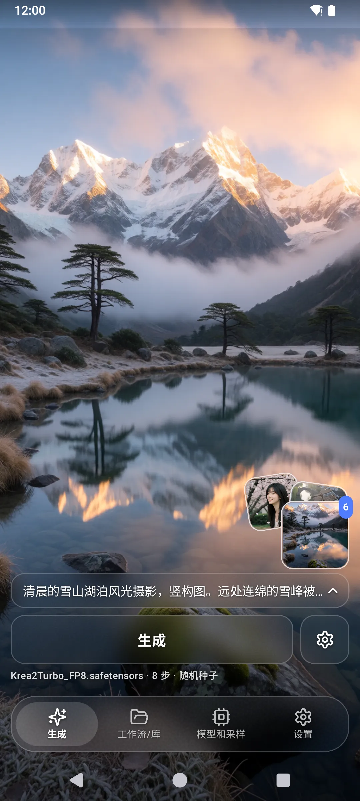 | 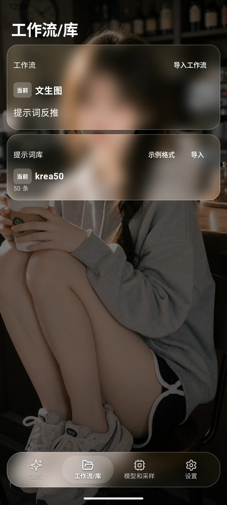 | 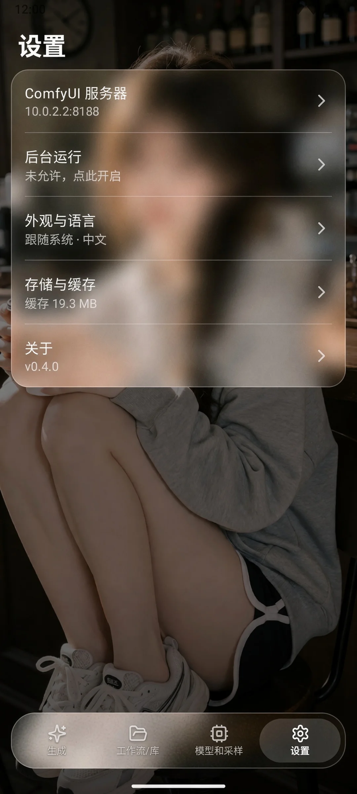 | 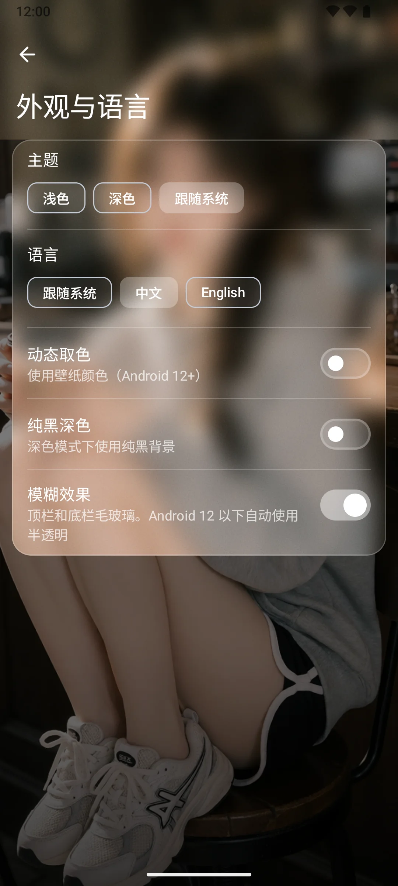 |

经典风格（在「设置 › 外观」里切换）：

| 浅色 · 生成 | 浅色 · 设置 | 深色 · 生成 | 深色 · 工作流/库 |
| --- | --- | --- | --- |
| 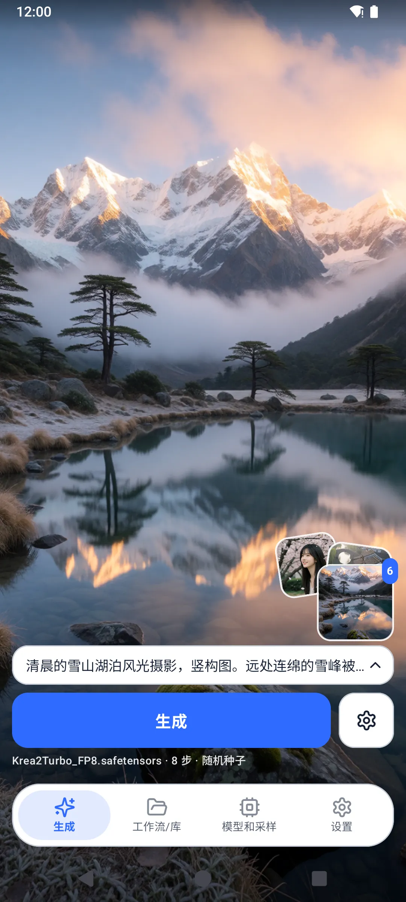 | 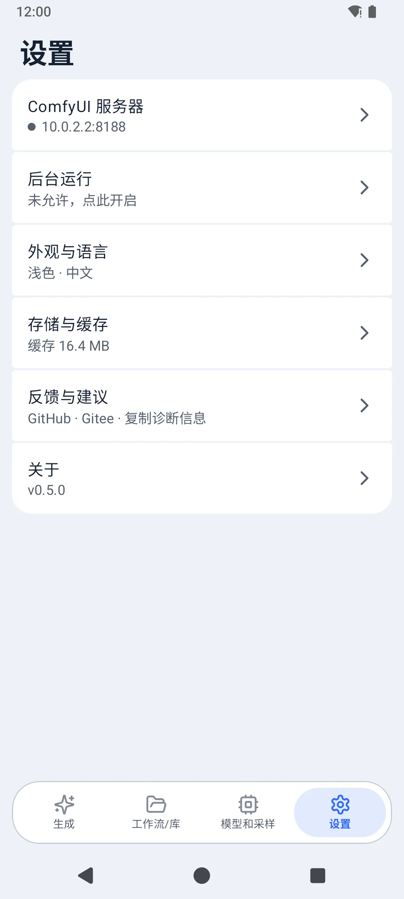 | 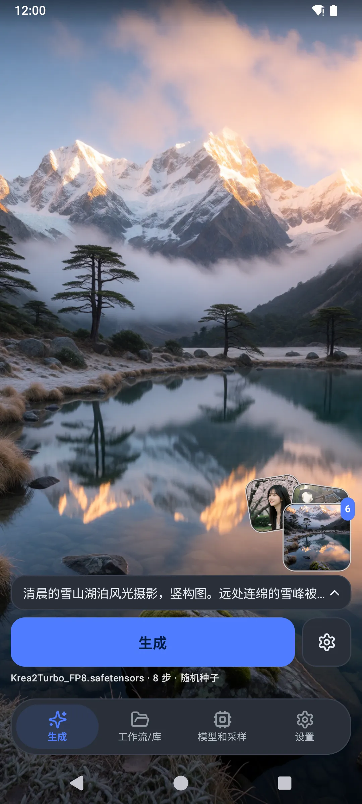 | 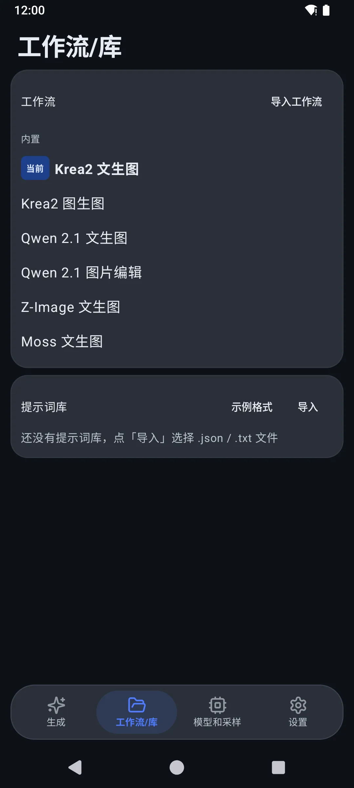 |

更多：

| 高级抽卡筛选 | 主页文本结果 | 画廊 |
| --- | --- | --- |
| 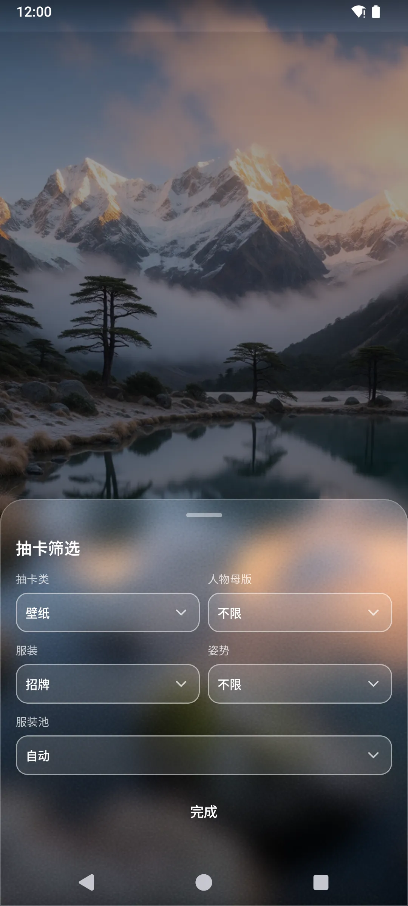 | 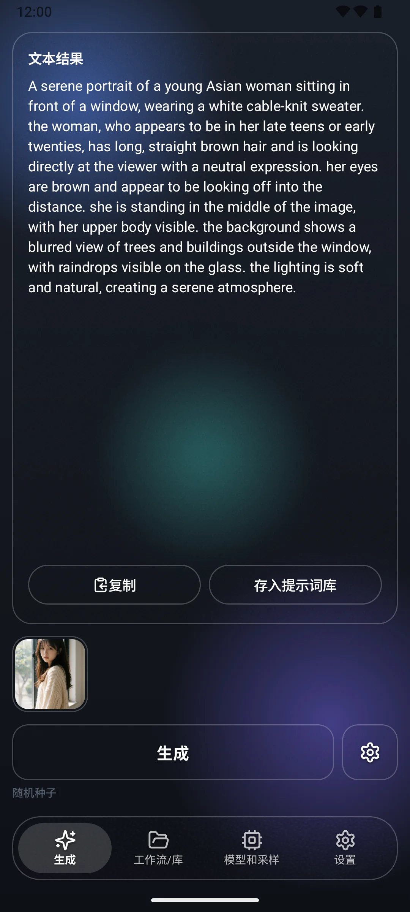 |  |

## 快速开始

> Android 8.0 及以上。Release APK 为 arm64-v8a / armeabi-v7a / x86 / x86_64 通用包。

1. 电脑上启动 ComfyUI 时加 `--listen 0.0.0.0`（只听 127.0.0.1 的话手机连不上），防火墙放行 8188
2. 从 Releases 安装 APK。首次打开会进入「快速开始」引导
3. **连服务器**：手机和电脑连同一个 Wi-Fi，点「自动查找」扫出电脑上的 ComfyUI，点一下填入，再点「测试连接」。扫不到就手动填 `http://<电脑局域网IP>:8188`（Windows 用 `ipconfig` 看 IPv4，例如 `http://192.168.1.100:8188`）。不用装蒲公英，也不用折腾 IPv6 / DDNS，下面的「远程访问」是出门在外才用的
4. **挑模板**：从 6 个内置模板里选一个（Krea2 文生图 / 图生图、Qwen 2.1 文生图 / 图片编辑、Z-Image 文生图、Moss 文生图）。模型名已预填官方默认文件名，电脑上装了对应官方模型就不用改；文件名不一样的话到「模型」页挑一下
5. 写提示词，点生成

小提示：界面里没有多余的按钮，二级操作都在**长按**里——比如长按工作流、提示词库里的条目会弹出菜单，长按服务器那一行可以编辑地址；生成按钮上直接写着「点按加入队列，长按取消」。

想用自己的工作流？见下方「自定义工作流（进阶）」。

## 远程访问

人不在家时才需要看这一节。局域网直接填 IP 即可。

默认面向局域网，通信是 HTTP 明文。人不在家时，选一种方式把家里的 ComfyUI 露给手机：

- **蒲公英组网**（中国大陆最省事）：手机和家里电脑加入同一网络，填家里电脑的虚拟 IP，如 `http://<虚拟 IP>:8188`
- **公网 IPv6 + DDNS**：域名指向家里电脑的 IPv6，再用 Caddy / Nginx 反代并开 Basic Auth（建议 HTTPS）。防火墙只放行反代端口，不要直接开放 8188。密码加密保存在手机本地
- **Tailscale**：填 Tailscale IP。海外稳，中国大陆可能不稳
- **frp / 花生壳等端口转发**：建议套 HTTPS，或给 ComfyUI 加访问保护

公网不要裸奔 8188。不可信网络不要走明文，走 VPN 或隧道。

家里一个地址、外面一个地址的话，两个都存成服务器，出门前在地址栏下拉里切一下就行。

## 自定义工作流（进阶）

内置模板不够用时再看这节。在 ComfyUI 网页端菜单「工作流」（新版叫「文件」）→「导出 (API)」/ Export (API) 导出 JSON（不是普通保存的界面格式），再到「工作流/库」导入。导入普通保存的界面格式时，App 会拦下并提示改用「导出 (API)」。导入时可以勾选要在手机上显示哪些参数，之后在工作流菜单里「编辑参数」随时改。

想在内置模板基础上改？在内置模板菜单里点「复制并自定义」。

工作流引用的模型、节点包，都得在 ComfyUI 那台机器上先装好。

## 进阶：高级抽卡服务

高级抽卡需要在电脑上跑一个很小的服务：[**gacha-server-lite**](https://github.com/Mimikkoro1/gacha-server-lite)。它从你的词库 JSON 里随机组合人物母版、服装、姿势、场景、表情，拼成一段提示词交给 App，出图仍走你自己的 ComfyUI。它不连 ComfyUI，也不出图。只在文生图工作流里可用。

1. 下载：

   ```bash
   git clone https://github.com/Mimikkoro1/gacha-server-lite.git
   ```

   不用 git 的话，在仓库页面点 Code → Download ZIP 解压。路径最好别带空格和中文
2. 装 Python 3.10 或更新版本（Windows 安装时勾选 “Add python.exe to PATH”）
3. 双击 `start.bat`（Linux / macOS 用 `./start.sh`）。第一次会自动建 `.venv` 并装依赖。看到 `listening on http://0.0.0.0:8787` 就是好了，窗口别关
4. 电脑上 `ipconfig` 查局域网 IPv4。App 里打开高级抽卡，在设置 → 连接的抽卡服务地址填：

   ```
   http://<电脑局域网IP>:8787
   ```

5. 点测试连接，显示延迟就通了

手机和电脑要在同一局域网。仓库自带的词库只是示例，换成你自己的；词库格式、改端口见 gacha-server-lite 的 README。这个服务没有鉴权，别直接暴露到公网。

## 构建

要求：JDK 17、Android SDK（`local.properties` 指向 SDK 路径）。

```bash
# Linux / macOS
./gradlew assembleRelease

# Windows
gradlew.bat assembleRelease
```

单元测试：`./gradlew testDebugUnitTest`（纯 JVM，不需要手机或模拟器）。

签名：复制 `keystore.properties.example` 为 `keystore.properties` 并填入 keystore。未配置时使用 debug 签名。

## FAQ

**连不上服务器 / 自动查找扫不到？** ComfyUI 要用 `--listen` 听 `0.0.0.0`。只听 `127.0.0.1` 时手机进不去。防火墙放行 8188。自动查找只走 WiFi 扫描，开着 VPN 也能找到，但访客网络、路由器 AP 隔离仍会扫不到；Android 17 上还要允许本应用访问局域网（连接前会有提示）。先用手机浏览器打开 `http://<ip>:8188` 看通不通。

**高级抽卡连不上？** 确认电脑上 `start.bat` 的窗口还开着，地址带 `http://`、结尾不要加 `/api/...`，防火墙放行 8787。电脑浏览器打开 `http://127.0.0.1:8787/api/masters` 能看到 JSON，说明服务本身正常。

**支持哪些模型？** 内置模板覆盖 Krea2、Qwen 2.1、Z-Image、Moss。除此之外应用不绑模型，你导入的工作流用什么，它就跑什么。

**会把图片传到云端吗？** 不会。流量只在手机和你的 ComfyUI 之间。

**和节点编辑器有什么区别？** 没有节点编辑器。结构在电脑上定死，手机只填参数、出图。

**怎么换成素色界面？** 「设置 › 外观」里把「界面风格」选成「经典」，想回来再选「毛玻璃」。经典风格下主题可选浅色 / 深色 / 跟随系统。升级后默认仍是毛玻璃，不会自己变。

**遇到问题怎么反馈？** 「设置」首页的「反馈与建议」可以直接跳到 GitHub 或 Gitee 提 issue，也能一键复制诊断信息（App 版本、系统版本、局域网权限、网络类型、服务器地址——账号密码已去掉——和最近一次连接测试的结果）。贴出去之前看一眼，地址是内网地址又不想公开的话自己涂掉。

**怎么升级？** 有新版时应用内会提示，点「更新」下载并安装；也可以从 Releases 下载新 APK 直接覆盖安装（签名一致，数据保留）。

## 已知问题

- 英文界面下，「模型和采样」页个别参数标签（如「采样 · steps」）仍是中文
- 经典风格下，生成页的系统导航栏图标（返回 / 主页）压在壁纸上时可能看不清
- 状态栏文字在个别壁纸和主题的组合下对比度偏低

遇到别的问题欢迎到「反馈与建议」里告诉我。

## License

[GPL-3.0](LICENSE)。

- UI 视觉思路参考自 [rikkahub](https://github.com/rikkahub/rikkahub)（AGPL-3.0），实现为独立编写
- 启动器图标使用了 [Comfy-Org/ComfyUI_frontend](https://github.com/Comfy-Org/ComfyUI_frontend) 的 ComfyUI logomark
- ComfyUI 及 ComfyUI 标志为 Comfy Org 的商标。本项目独立开发，与 Comfy Org 无关

---

<a id="english"></a>

## English

[中文](#zh) | **English**

**Comfy Workbench** is a native Android app that drives your own ComfyUI. It ships with 6 built-in templates, so you can generate right after install; you can also export your own workflow as API-format JSON and import it. The parameters become a few fields: prompt, seed, size, reference image, or one reference video. Tap once. It submits to your own ComfyUI over HTTP + WebSocket. No cloud in between.

It is not a node editor, and it does not replace the ComfyUI web UI. Graphs stay on the computer. The phone only runs them.

**0.5.0 is the first stable release.** The core direct-to-ComfyUI experience has settled; from here on, updates will mostly follow your feedback rather than frequent releases.

**Quick start (same Wi-Fi, nothing else to install)**

1. Start ComfyUI with `--listen 0.0.0.0` (if it only listens on 127.0.0.1 the phone can't reach it) and allow port 8188 through the firewall
2. Install the APK from Releases. The Quick Start guide opens on first launch
3. Connect: with the phone on the same Wi-Fi, tap "Find on network" to discover ComfyUI, tap the result, then "Test connection". Or enter `http://<PC LAN IP>:8188` by hand (find the IPv4 with `ipconfig`, e.g. `http://192.168.1.100:8188`)
4. Pick one of 6 built-in templates (Krea2 text-to-image / image-to-image, Qwen 2.1 text-to-image / image edit, Z-Image text-to-image, Moss text-to-image). Official default model file names are prefilled; pick other files on the Models tab if yours differ
5. Write a prompt and generate

Tip: the UI has no extra buttons; secondary actions are on **long-press**. Long-press an item in Workflows or Prompt libraries for its menu, long-press the server row to edit it, and the Generate button itself says "Tap to queue, long-press to cancel".

Your own workflow (advanced): ComfyUI web UI, Workflow menu (File in newer versions) → Export (API), then import it under Workflows. A regular saved workflow is rejected with a hint to re-export. You choose which parameters to show and can edit that later; built-in templates can be "Copied & customized".

Remote access (Pgyer, IPv6 + DDNS, Tailscale) is only for using it away from home.

**New in v0.5.0** (older releases: [Releases](https://github.com/Mimikkoro1/comfy-workbench-android/releases))

- **Two interface styles**: Settings › Appearance now has a "Style" option, "Glass" (the default; existing users stay on it after updating) and "Classic" (solid, plain surfaces). Classic supports Light / Dark / System, plus Dynamic color and True black on Android 12+
- **In-app updates**: update checks try Gitee first in China and fall back to GitHub; release notes follow the app language; new versions download and install inside the app
- **Smoother connection setup**: handles Android 17's local-network permission; auto-discovery scans over WiFi only and works with a VPN running; server addresses can omit the scheme, port or trailing slash; connection failures say which step failed and can be copied as diagnostics; the Settings home shows a server status dot (green / red / grey)
- **A more reliable queue**: "Force stop" also clears the ComfyUI server's queue; tap a queued job to cancel it, and a "Force clear queue" exit appears when a job has waited too long; on launch the app reconciles with the server's queue and history, so no more ghost "queued" jobs
- **Errors you can read**: common problems such as a missing model get a one-line explanation, with ComfyUI's original message under "Show original"; failed generations show a prominent error bar that opens to the node, exception and traceback and can be copied in one tap; missing models are highlighted on the Models page
- **More accurate custom-workflow import**: results prefer SaveImage over PreviewImage temp files; imported ResolutionSelector nodes get an aspect-ratio dropdown; sampler parameters (steps / CFG / sampler / scheduler, including KSamplerAdvanced two-stage samplers) are shown by default on the Models page; dropdown options are cached locally so you still see the last choices when the PC is off
- **Stability and polish**: failed image downloads can be retried with a tap; every finished job gets its own notification; video resumes where it was after fullscreen or rotation; no more paused jobs spinning up when offline; system backup and device transfer no longer carry the server address or credentials; lower background power use
- **Feedback entry**: Settings home now has "Feedback & suggestions" (GitHub / Gitee) with one-tap diagnostics copy

**What it does and doesn't do**

- A dropped connection does not drop the job. The task is stored before submit; progress may disconnect, and status comes from the queue and history
- Prompts are detected on CLIPTextEncode and TextEncode-style nodes such as Qwen; 11 built-in size presets including 9:16
- Imported workflows must be API format. The default `nodes` / `links` file must be exported with Export (API) first (not needed for built-in templates)
- LoRA loaders can be toggled and weighted on the phone; workflows with a video upload slot accept a reference video
- One reference video. Imports with more than one video slot are rejected
- Linked inputs are not exposed. Only literal parameters become controls
- Custom sizes are aligned down to a multiple of 16 (minimum 64)
- Android 8.0+. The release APK is a universal build (arm64-v8a / armeabi-v7a / x86 / x86_64)
- Generation and downloads run in a foreground service, so they finish with the screen locked
- Gallery stays inside the app and is **not** auto-saved to the system album
- LAN or remote addresses, several saved servers. HTTP Basic Auth behind Caddy / Nginx; the login fields expand on 401
- Two UI styles, Glass (default) and Classic, switched under Settings › Appearance; Chinese and English UI, following the system language unless you switch it
- Queue: the Generate button says "Tap to queue, long-press to cancel"; tap a queued job to cancel it; "Force stop all" also clears the ComfyUI queue
- Update check asks at most once a day (Gitee first in China, then GitHub), or manually from About. The app only downloads and installs after you tap Update; nothing is auto-downloaded and no data is collected

Model files and custom nodes used by a workflow must exist on your ComfyUI machine.

Remote access (optional, only away from home): on mainland China, Oray Pgyer (蒲公英) is the simplest mesh. Public IPv6 + DDNS with a Caddy / Nginx reverse proxy and Basic Auth also works; open only the proxy port, never 8188 itself. Tailscale is fine outside China and can be unstable on the mainland. Plain HTTP on an untrusted network should go through a tunnel.

**Advanced gacha server.** Clone [gacha-server-lite](https://github.com/Mimikkoro1/gacha-server-lite) (`git clone https://github.com/Mimikkoro1/gacha-server-lite.git`), install Python 3.10+, and double-click `start.bat` (`./start.sh` on Linux / macOS). The first run creates `.venv` and installs the dependencies; the default port is 8787. In the app, turn on advanced gacha and enter `http://<PC LAN IP>:8787` as the gacha service address under Settings → Connection. Phone and PC must be on the same LAN. The server has no authentication, so don't expose it to the internet. Text-to-image workflows only.

### Screenshots

Glass (default):

| Generate | Workflows / Library | Settings | Appearance & language |
| --- | --- | --- | --- |
| 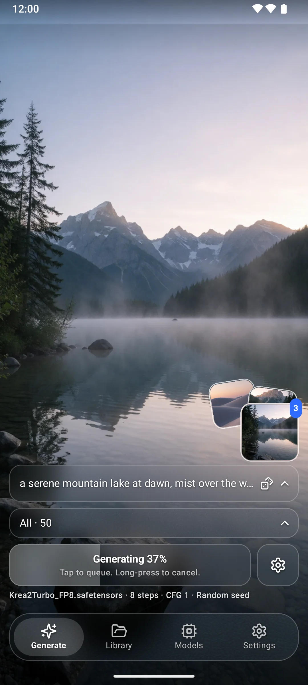 | 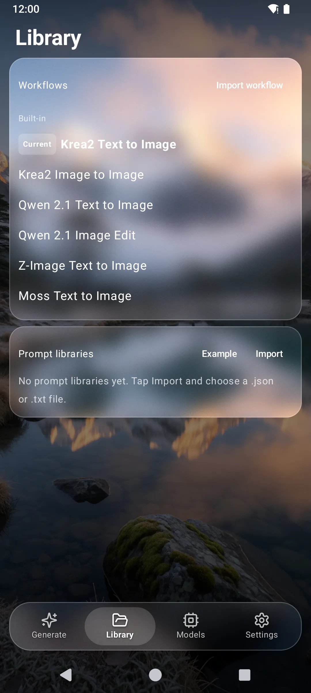 | 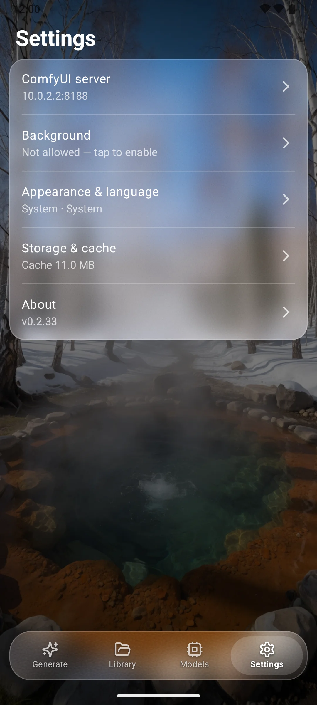 | 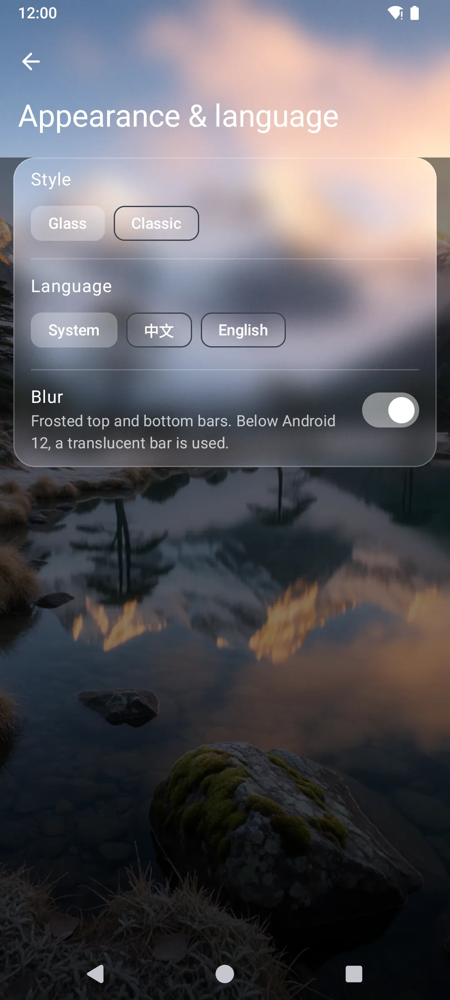 |

Classic (switch under Settings › Appearance):

| Light · Generate | Light · Settings | Dark · Generate | Dark · Workflows / Library |
| --- | --- | --- | --- |
| 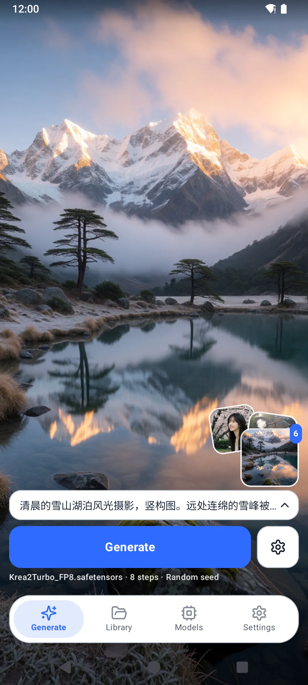 | 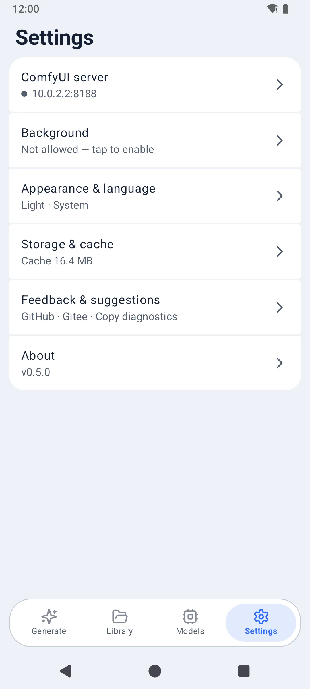 |  | 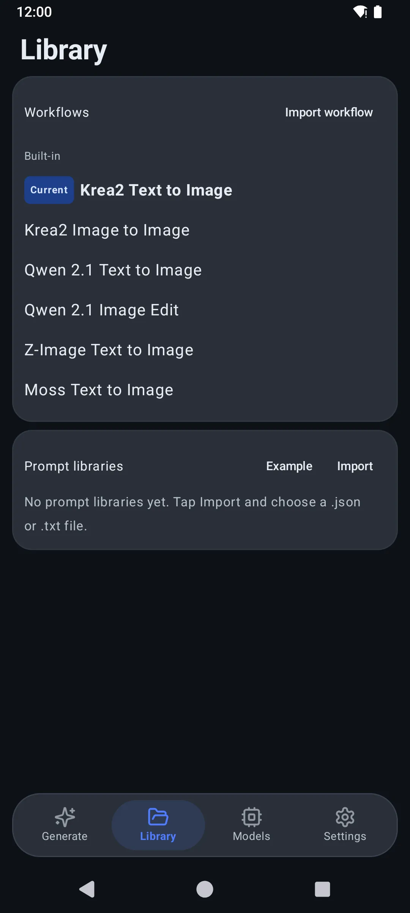 |

More:

| Gacha filters | Text result on Generate | Gallery |
| --- | --- | --- |
| 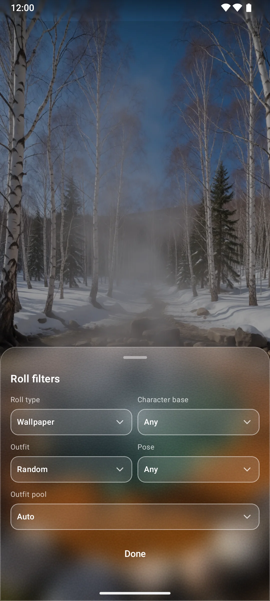 | 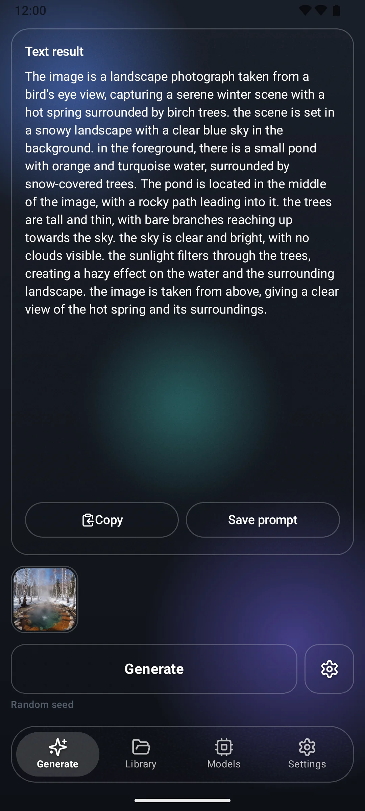 | 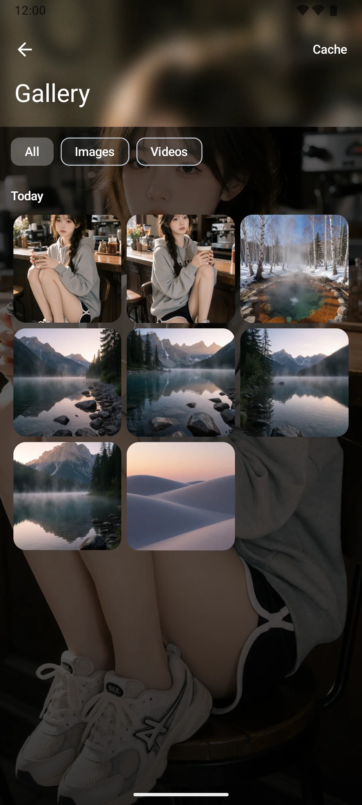 |

**Plain UI?** Settings › Appearance › Style › "Classic" (switch back to "Glass" any time). **Feedback?** Settings home › "Feedback & suggestions" opens GitHub / Gitee issues and can copy diagnostics (app version, Android version, LAN permission, network type, server address with credentials stripped, and the last connection test result). **Upgrading?** Tap Update when the app offers it, or install a new APK from Releases over the old one (same signature, data kept).

**Known issues**

- In the English UI a few parameter labels on the Models page (e.g. "采样 · steps") are still in Chinese
- In Classic style the system navigation icons (back / home) can be hard to see over the wallpaper on the Generate page
- Status-bar text contrast is low with some wallpaper and theme combinations

Build: JDK 17 + Android SDK, then `./gradlew assembleRelease`. Unit tests (plain JVM, no device): `./gradlew testDebugUnitTest`.

Licensed under **GPL-3.0**. Unofficial project, not affiliated with Comfy Org. ComfyUI and the ComfyUI logo are trademarks of Comfy Org.

## 关于

个人项目，按自己的工作流打磨。欢迎 issue 和 PR。
