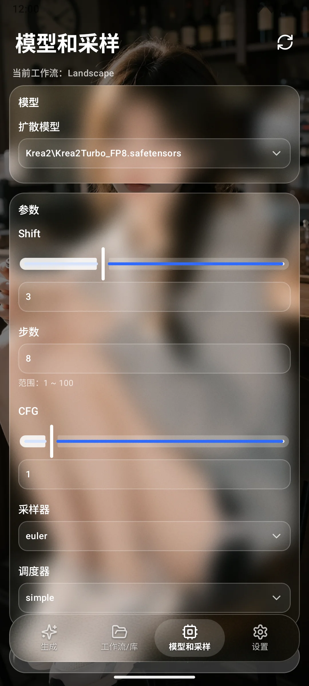
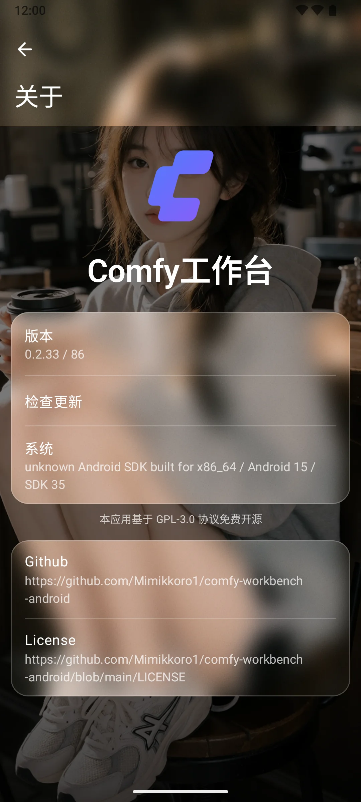
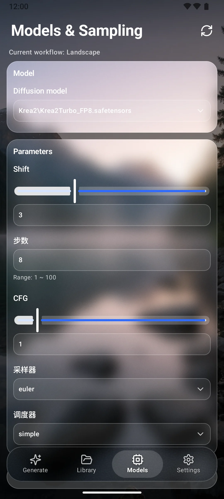
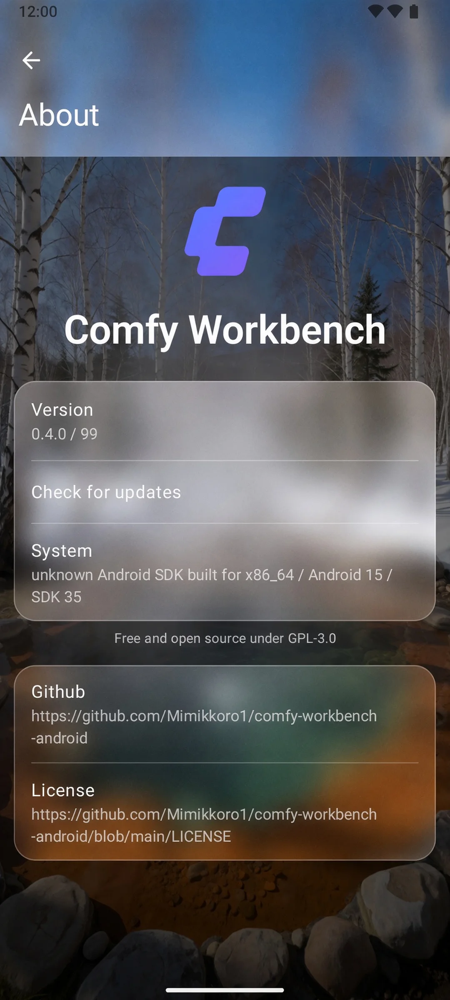

# Comfy工作台（Comfy Workbench）

> 导入一条工作流，手机上点一下出图。不连线，不改节点。

[](LICENSE) [](https://github.com/Mimikkoro1/comfy-workbench-android/actions/workflows/android-ci.yml)

**Comfy工作台** 是一个原生 Android（Kotlin + Jetpack Compose）应用。电脑上把 ComfyUI 工作流导出成 API 格式，手机里导入，参数变成几个输入框：提示词、种子、尺寸、参考图、一条参考视频。点一下就提交到你自己的 ComfyUI。

它不是手机上的节点编辑器，也不替代 ComfyUI 网页端。节点和连线留在电脑上，手机只负责出图。

人不在电脑前，也能用同一套已经调好的工作流出图、图生图、图生视频、反推提示词。

## v0.3.0 新在哪

- **毛玻璃沉浸式界面**：最新一张图铺满做背景，生成、工作流/库、模型、设置、看图、图库都换成玻璃卡片。底部面板滑入滑出、跟手下拉回弹，弹窗淡入淡出。Android 12 以下或关掉模糊时自动退成半透明
- **多台服务器**：可以存好几台 ComfyUI（各带名称和账号密码），地址栏下拉一点就切
- **取消和报错更靠谱**：生成按钮上直接显示百分比；点按看队列，长按取消当前这条。服务器连不上时立刻报错，不会一直「生成中」；切换地址会自动收掉旧任务；设置 → 连接里有「强制结束全部任务」兜底。弱网下已经提交的任务照样能取回结果
- **文本结果留在主页**：反推提示词这类只出文字的工作流，结果直接显示在生成页，可复制、可存进提示词库
- **看图页重新生成**：用这张图的提示词再来一张（种子随机）；图片信息里的提示词可一键入库
- **高级抽卡（可选）**：连上电脑上的 [gacha-server-lite](https://github.com/Mimikkoro1/gacha-server-lite)，从你的词库随机拼人物、服装、姿势。筛选项由服务端下发，服务端没有的维度不显示。见下方「进阶：高级抽卡服务」

## 它做什么

- **直连你的 ComfyUI**：HTTP + WebSocket，实时进度，没有云端中转。提示词、参数、图片只经过手机和你自己的机器
- **断线任务还在**：提交前先落库。进度条可以断，任务以队列和历史为准，重连后继续查，不靠那条 WebSocket 活着
- **工作流变操作面板**：导入 API 格式 JSON，把提示词、尺寸、步数、种子、模型、参考图映射成手机控件。提示词识别 CLIPTextEncode 和 Qwen 等 TextEncode 节点；内置 11 个尺寸预设（含 9:16 竖屏）。示例在 `docs/example-workflows/`
- **LoRA 与参考视频**：工作流里的 LoRA 加载器可在手机上开关、调强度；带视频上传槽的工作流可以选一段视频当参考
- **文本结果**：反推提示词等文字输出直接显示在生成页，可复制、存入提示词库
- **提示词库**：分类取词、随机抽卡、保存和编辑
- **画廊**：图片 / 视频统一浏览，可放大、可播放。结果只进 App 图库，**不自动写入系统相册**，要留的再手动保存或分享
- **后台跑完**：生成和下载走前台服务，锁屏或切走不会中断，通知栏能看到进度
- **远程也能用**：内网或外网地址都行，可以存多台服务器下拉切换。外网可配 HTTP Basic Auth（适合 Caddy / Nginx），遇到 401 会展开账号密码
- **队列**：多条任务排队；点按查看队列，长按取消当前任务；连不上立即失败；可一键强制结束全部任务
- **界面**：毛玻璃沉浸式，单手操作。中英双语，默认跟系统语言，设置里可改
- **更新检查**：每天最多问一次 GitHub，也可在「关于」里手动查。不自动下载，不收集数据

## 它不做什么

- 不能在手机上连线、改节点、搭新图。要改结构，回 ComfyUI 网页端改完再导出
- 只吃 **API 格式** JSON。网页端默认的 `nodes` / `links` 工作流要先用「Export (API)」导出
- 参考视频只支持一条。多条视频槽导入时会拦住
- 面板控件来自工作流里的字面量参数。已经连到别的节点的输入不会再暴露出来
- 自定义尺寸会按 16 的倍数对齐（最小 64）。不是 16 的倍数会被改小
- 不自带抽卡词库。高级抽卡要在电脑上另跑 gacha-server-lite，词库是你自己的 JSON

## 截图

| 生成 | 工作流/库 | 模型 | 设置 |
| --- | --- | --- | --- |
|  |  |  |  |

| 高级抽卡筛选 | 关于 | 外观 | 主页文本结果 |
| --- | --- | --- | --- |
|  |  |  |  |

| 画廊 |
| --- |
|  |

## 快速开始

> Android 8.0 及以上。Release APK 为 arm64-v8a / armeabi-v7a / x86 / x86_64 通用包。

1. 电脑上启动 ComfyUI 时加 `--listen 0.0.0.0`（只听 127.0.0.1 的话手机连不上），防火墙放行 8188
2. **同一个 Wi-Fi 直接就能连**：手机和电脑连同一个 Wi-Fi，App 里填 `http://<电脑局域网IP>:8188`（Windows 用 `ipconfig` 看 IPv4，例如 `http://192.168.1.100:8188`）。不用装蒲公英，也不用折腾 IPv6 / DDNS，下面的「远程访问」是出门在外才用的
3. 从 Releases 安装 APK，填地址，连上就能用
4. 在「工作流/库」导入一条 **API 格式** 工作流：ComfyUI 网页端菜单「工作流」（新版叫「文件」）→「导出 (API)」。普通保存的界面格式导入时会被拦下，并提示改用「导出 (API)」

## 远程访问

人不在家时才需要看这一节。局域网直接填 IP 即可。

默认面向局域网，通信是 HTTP 明文。人不在家时，选一种方式把家里的 ComfyUI 露给手机：

- **蒲公英组网**（中国大陆最省事）：手机和家里电脑加入同一网络，填家里电脑的虚拟 IP，如 `http://<虚拟 IP>:8188`
- **公网 IPv6 + DDNS**：域名指向家里电脑的 IPv6，再用 Caddy / Nginx 反代并开 Basic Auth（建议 HTTPS）。防火墙只放行反代端口，不要直接开放 8188。密码加密保存在手机本地
- **Tailscale**：填 Tailscale IP。海外稳，中国大陆可能不稳
- **frp / 花生壳等端口转发**：建议套 HTTPS，或给 ComfyUI 加访问保护

公网不要裸奔 8188。不可信网络不要走明文，走 VPN 或隧道。

家里一个地址、外面一个地址的话，两个都存成服务器，出门前在地址栏下拉里切一下就行。

## 自定义工作流

在 ComfyUI 网页端用「导出 (API)」/ Export (API) 导出 JSON（不是普通保存的界面格式），再到应用里导入。导入普通保存的界面格式时，App 会拦下并提示改用「导出 (API)」。`docs/example-workflows/` 里有四条能直接对一下格式的例子：

- `kr2turbo_t2i.workflow.json` — 文生图（Krea 2 Turbo）
- `kr2turbo_i2i.workflow.json` — 图生图
- `wan22_i2v_4step.workflow.json` — 图生视频（Wan2.2，4 步）
- `florence2_caption.workflow.json` — Florence-2 图片反推提示词

示例里的模型名要换成你机器上实际有的文件。工作流引用的模型、节点包，都得在 ComfyUI 那台机器上先装好。

## 进阶：高级抽卡服务

高级抽卡需要在电脑上跑一个很小的服务：[**gacha-server-lite**](https://github.com/Mimikkoro1/gacha-server-lite)。它从你的词库 JSON 里随机组合人物母版、服装、姿势、场景、表情，拼成一段提示词交给 App，出图仍走你自己的 ComfyUI。它不连 ComfyUI，也不出图。只在文生图工作流里可用。

1. 下载：

   ```bash
   git clone https://github.com/Mimikkoro1/gacha-server-lite.git
   ```

   不用 git 的话，在仓库页面点 Code → Download ZIP 解压。路径最好别带空格和中文
2. 装 Python 3.10 或更新版本（Windows 安装时勾选 “Add python.exe to PATH”）
3. 双击 `start.bat`（Linux / macOS 用 `./start.sh`）。第一次会自动建 `.venv` 并装依赖。看到 `listening on http://0.0.0.0:8787` 就是好了，窗口别关
4. 电脑上 `ipconfig` 查局域网 IPv4。App 里打开高级抽卡，在设置 → 连接的抽卡服务地址填：

   ```
   http://<电脑局域网IP>:8787
   ```

5. 点测试连接，显示延迟就通了

手机和电脑要在同一局域网。仓库自带的词库只是示例，换成你自己的；词库格式、改端口见 gacha-server-lite 的 README。这个服务没有鉴权，别直接暴露到公网。

## 构建

要求：JDK 17、Android SDK（`local.properties` 指向 SDK 路径）。

```bash
# Linux / macOS
./gradlew assembleRelease

# Windows
gradlew.bat assembleRelease
```

单元测试：`./gradlew testDebugUnitTest`（纯 JVM，不需要手机或模拟器）。

签名：复制 `keystore.properties.example` 为 `keystore.properties` 并填入 keystore。未配置时使用 debug 签名。

## FAQ

**连不上服务器？** ComfyUI 要用 `--listen` 听 `0.0.0.0`。只听 `127.0.0.1` 时手机进不去。防火墙放行 8188。先用手机浏览器打开 `http://<ip>:8188` 看通不通。

**高级抽卡连不上？** 确认电脑上 `start.bat` 的窗口还开着，地址带 `http://`、结尾不要加 `/api/...`，防火墙放行 8787。电脑浏览器打开 `http://127.0.0.1:8787/api/masters` 能看到 JSON，说明服务本身正常。

**支持哪些模型？** 应用不绑模型。你导入的工作流用什么，它就跑什么。

**会把图片传到云端吗？** 不会。流量只在手机和你的 ComfyUI 之间。

**和节点编辑器有什么区别？** 没有节点编辑器。结构在电脑上定死，手机只填参数、出图。

## License

[GPL-3.0](LICENSE)。

- UI 视觉思路参考自 [rikkahub](https://github.com/rikkahub/rikkahub)（AGPL-3.0），实现为独立编写
- 启动器图标使用了 [Comfy-Org/ComfyUI_frontend](https://github.com/Comfy-Org/ComfyUI_frontend) 的 ComfyUI logomark
- ComfyUI 及 ComfyUI 标志为 Comfy Org 的商标。本项目独立开发，与 Comfy Org 无关

---

## English

**Comfy Workbench** is a native Android app for a workflow you already finished on your PC. Export it as API-format JSON, import it on the phone, and the parameters become a few fields: prompt, seed, size, reference image, or one reference video. Tap once. It submits to your own ComfyUI over HTTP + WebSocket. No cloud in between.

It is not a node editor, and it does not replace the ComfyUI web UI. Graphs stay on the computer. The phone only runs them.

**Quick start (same Wi-Fi, nothing else to install)**

1. Start ComfyUI with `--listen 0.0.0.0` (if it only listens on 127.0.0.1 the phone can't reach it) and allow port 8188 through the firewall
2. Put the phone on the same Wi-Fi, install the APK from Releases, and enter `http://<PC LAN IP>:8188` (find the IPv4 with `ipconfig`, e.g. `http://192.168.1.100:8188`)
3. Import an **API-format** workflow: in the ComfyUI web UI, Workflow menu (File in newer versions) → Export (API). A regular saved workflow is rejected with a hint to re-export

Remote access (Pgyer, IPv6 + DDNS, Tailscale) is only for using it away from home.

**New in v0.3.0**

- Frosted-glass immersive UI: your latest image fills the background, and every screen uses glass cards. Bottom sheets slide in and out and follow your finger; dialogs fade. Falls back to translucent panels below Android 12 or with blur turned off
- Several saved ComfyUI servers, each with its own name and login, switched from the address dropdown
- Reliable cancel: percentage progress on the Generate button, tap for the queue, long-press to cancel the current job. An unreachable server fails right away instead of spinning forever; switching servers ends the old jobs; Settings → Connection has "Force-cancel all tasks". Jobs already submitted still come back on a flaky network
- Text-only workflows such as prompt captioning show their result on the Generate screen, with copy and save-to-library
- Regenerate from the viewer (same prompt, random seed); save an image's prompt to a library in one tap
- Optional advanced gacha via [gacha-server-lite](https://github.com/Mimikkoro1/gacha-server-lite): the server sends the filter options, and dimensions it doesn't have are hidden

**What it does and doesn't do**

- A dropped connection does not drop the job. The task is stored before submit; progress may disconnect, and status comes from the queue and history
- Prompts are detected on CLIPTextEncode and TextEncode-style nodes such as Qwen; 11 built-in size presets including 9:16
- API-format workflows only. The default `nodes` / `links` file must be exported with Export (API) first
- LoRA loaders can be toggled and weighted on the phone; workflows with a video upload slot accept a reference video
- One reference video. Imports with more than one video slot are rejected
- Linked inputs are not exposed. Only literal parameters become controls
- Custom sizes are aligned down to a multiple of 16 (minimum 64)
- Android 8.0+. The release APK is a universal build (arm64-v8a / armeabi-v7a / x86 / x86_64)
- Generation and downloads run in a foreground service, so they finish with the screen locked
- Gallery stays inside the app and is **not** auto-saved to the system album
- LAN or remote addresses, several saved servers. HTTP Basic Auth behind Caddy / Nginx; the login fields expand on 401
- Chinese and English UI, following the system language unless you switch it
- Update check asks GitHub at most once a day, or manually from About. No auto-download, no data collected

Examples: `docs/example-workflows/` (Krea 2 Turbo t2i / i2i, Wan2.2 i2v, Florence-2 caption). Model files named in those workflows must exist on your ComfyUI machine.

Remote access (optional, only away from home): on mainland China, Oray Pgyer (蒲公英) is the simplest mesh. Public IPv6 + DDNS with a Caddy / Nginx reverse proxy and Basic Auth also works; open only the proxy port, never 8188 itself. Tailscale is fine outside China and can be unstable on the mainland. Plain HTTP on an untrusted network should go through a tunnel.

**Advanced gacha server.** Clone [gacha-server-lite](https://github.com/Mimikkoro1/gacha-server-lite) (`git clone https://github.com/Mimikkoro1/gacha-server-lite.git`), install Python 3.10+, and double-click `start.bat` (`./start.sh` on Linux / macOS). The first run creates `.venv` and installs the dependencies; the default port is 8787. In the app, turn on advanced gacha and enter `http://<PC LAN IP>:8787` as the gacha service address under Settings → Connection. Phone and PC must be on the same LAN. The server has no authentication, so don't expose it to the internet. Text-to-image workflows only.

### Screenshots

| Generate | Workflows / Library | Models | Settings |
| --- | --- | --- | --- |
|  |  |  |  |

| Gacha filters | About | Appearance | Text result on Generate |
| --- | --- | --- | --- |
|  |  |  |  |

| Gallery |
| --- |
|  |

Build: JDK 17 + Android SDK, then `./gradlew assembleRelease`. Unit tests (plain JVM, no device): `./gradlew testDebugUnitTest`.

Licensed under **GPL-3.0**. Unofficial project, not affiliated with Comfy Org. ComfyUI and the ComfyUI logo are trademarks of Comfy Org.

## 关于

个人项目，按自己的工作流打磨。欢迎 issue 和 PR。
